  

 

I build products end to end: **React Native** apps on Android and iOS, **Next.js** web platforms, and the **Node.js / NestJS** APIs behind them. Currently I'm a Full-Stack Developer at **Restro Edge**, where I own every production surface of [RestoCare](https://restocare.in/), a restaurant-management platform that's live on the Play Store and the App Store.

- **Now:** RestoCare Customer &amp; Partner apps, the web admin, and the API that serves them
- **Sharpening:** backend architecture with NestJS, Prisma and PostgreSQL, plus performance and developer experience
- **Ask me about:** React Native, Next.js, Node.js, state management, shipping to both app stores

## Featured work

<table>
  <tr>
    <td width="50%" valign="top">
      <h3>🍽️ <a href="https://restocare.in/">RestoCare</a></h3>
      
<strong>Restaurant management platform</strong> Full-Stack Developer · Restro Edge · Jul 2025 → present

      
Customer and Partner apps on Android &amp; iOS, the web admin, and the API behind them. I build and maintain all four surfaces in production.

      
<code>React Native</code> <code>Next.js</code> <code>NestJS</code> <code>PostgreSQL</code> <code>Supabase</code>

      

        
        
        
      

    </td>
    <td width="50%" valign="top">
      <h3>🏠 <a href="https://pzee.in/">Pzee Finder</a></h3>
      
<strong>Property &amp; PG discovery platform</strong> Full-Stack Developer · Jan 2026 → Aug 2026

      
Mobile app and web platform on a NestJS backend built to scale: Prisma on PostgreSQL, Redis on the hot paths, BullMQ jobs, S3 uploads and Supabase auth.

      
<code>React Native</code> <code>Next.js</code> <code>NestJS</code> <code>Prisma</code> <code>PostgreSQL</code> <code>Redis</code>

      

        
        
        
        
      

    </td>
  </tr>
  <tr>
    <td width="50%" valign="top">
      <h3>🤖 <a href="https://github.com/prakash116/AI-creator-marketplace">CRE8R</a></h3>
      
<strong>AI creator marketplace MVP</strong> Personal project · 2026

      
Connects AI-native creators with brands and agencies. Next.js 16 App Router frontend with Framer Motion and React Three Fiber, on a NestJS 11 API with JWT auth, Mongoose models and signed Cloudinary uploads.

      
<code>Next.js</code> <code>TypeScript</code> <code>NestJS</code> <code>MongoDB</code> <code>Tailwind CSS</code>

      

        
        
      

    </td>
    <td width="50%" valign="top">
      <h3>🎓 <a href="https://www.edunovas.in/">Edunovas</a></h3>
      
<strong>EdTech platform website</strong> Tech Head · 2026

      
Led the build of a 3D-accented marketing platform for robotics and AI courses, with Google Sheets as the content layer so educators publish without a deploy.

      
<code>Next.js</code> <code>TypeScript</code> <code>Tailwind CSS</code> <code>Framer Motion</code> <code>Three.js</code>

      

        
        
      

    </td>
  </tr>
</table>

  
    More: <a href="https://github.com/prakash116/NEETWeb">NEET Exam System</a> (Next.js + NestJS) &nbsp;•&nbsp;
    <a href="https://github.com/prakash116/Staff_Solutions">Aurevia Staffing</a> (Next.js, live) &nbsp;•&nbsp;
    <a href="https://github.com/prakash116/Chat-App">Real-time Chat</a> (Socket.IO + MERN) &nbsp;•&nbsp;
    <a href="https://github.com/prakash116?tab=repositories">all 40+ repos →</a>
  

## Stack

  
   
  <strong>Mobile:</strong> React Native · Expo &nbsp;•&nbsp; <strong>Realtime &amp; jobs:</strong> Socket.IO · BullMQ &nbsp;•&nbsp; <strong>Motion &amp; 3D:</strong> Framer Motion · Three.js &nbsp;•&nbsp; <strong>Media:</strong> Cloudinary · AWS S3

## Activity

  
  
    
  <!-- Generated by .github/workflows/contribution-games.yml — the game appears after the workflow's first run on GitHub -->
  <picture>
    <source media="(prefers-color-scheme: dark)" srcset="https://raw.githubusercontent.com/prakash116/prakash116/output/pacman-contribution-graph-dark.svg" />
    <source media="(prefers-color-scheme: light)" srcset="https://raw.githubusercontent.com/prakash116/prakash116/output/pacman-contribution-graph.svg" />
    
  </picture>
   
  Pac-Man vs. my contribution graph · regenerated every night by GitHub Actions

## Connect

  
  
  
  
    
  

